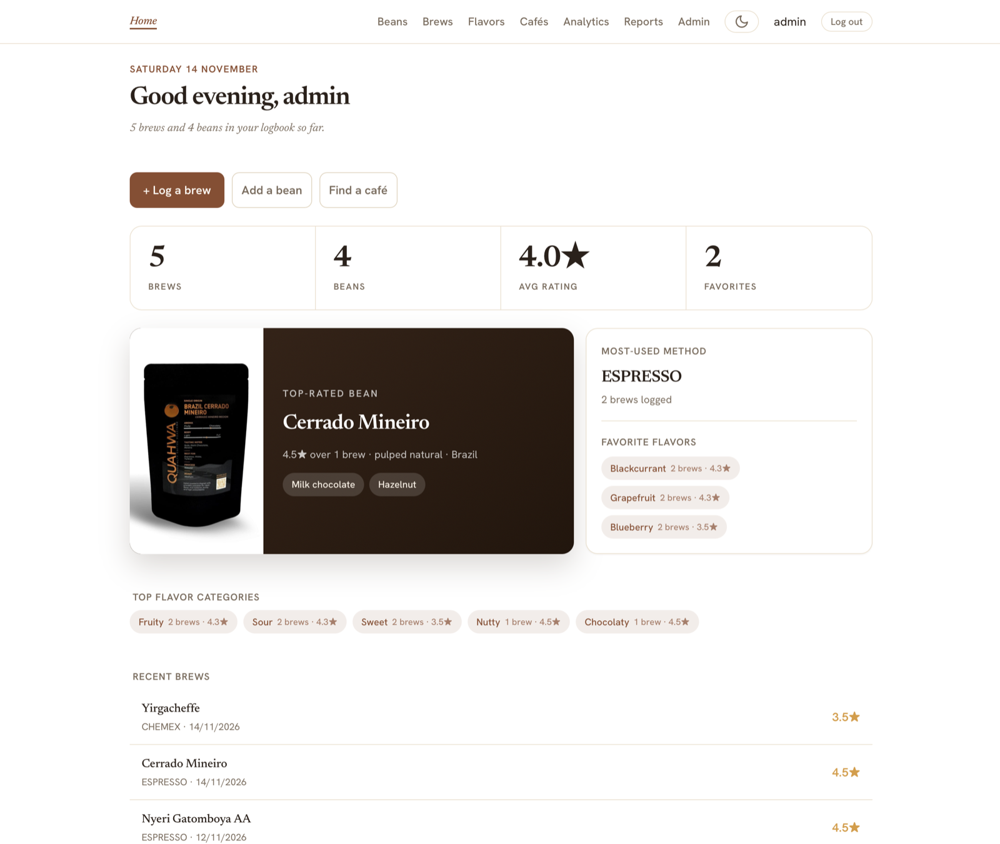
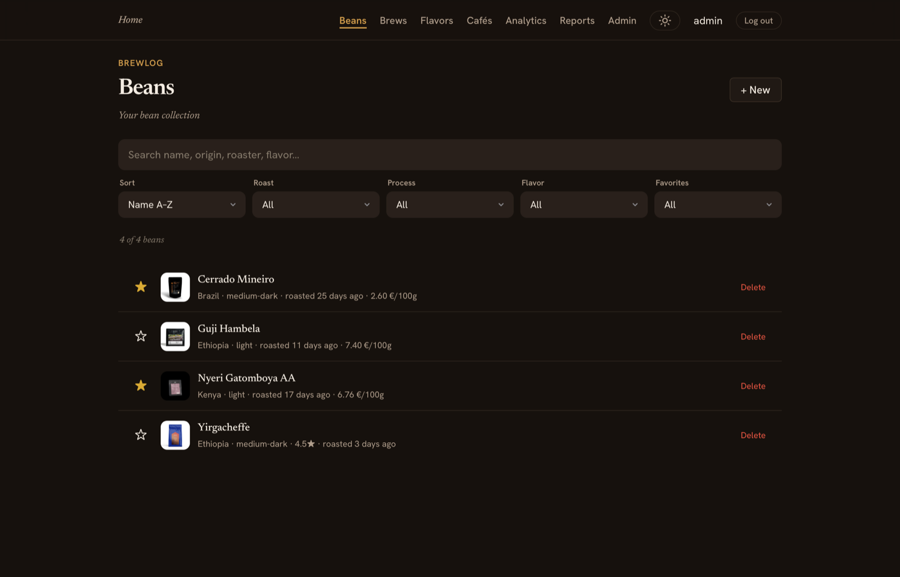
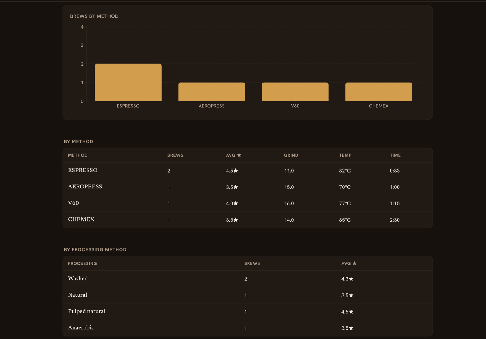
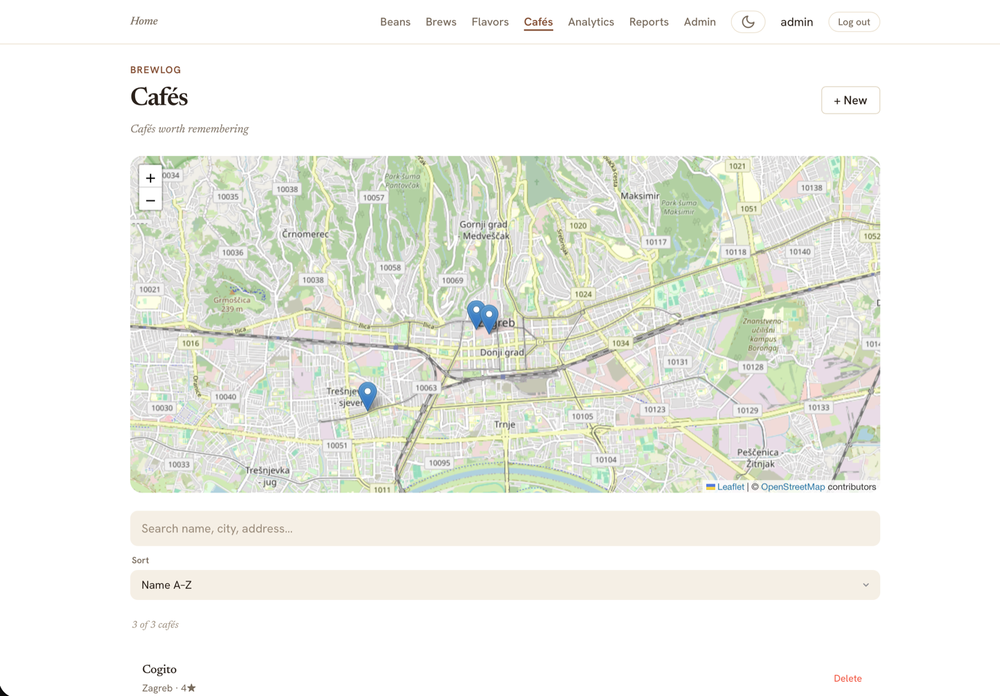

# BrewLog

BrewLog is a full-stack app for specialty coffee enthusiasts: log brewing sessions, manage coffee beans and
flavor notes, find cafés on a map, and get automatic weekly and monthly reports on your brewing habits.
It runs as a web app and as an iOS app (Capacitor).

| Home | Beans (dark mode) |
| --- | --- |
|  |  |
| **Analytics** | **Café map** |
|  |  |

## Tech stack

- **Backend:** Java 25, Spring Boot 4, Spring Security (JWT + Google OAuth2), Spring Data JPA, Quartz, Flyway
- **Database:** PostgreSQL (production), H2 (local development)
- **Frontend:** React, TypeScript, Vite, Recharts, Leaflet; iOS build via Capacitor
- **Testing:** JUnit 5, Mockito, MockMvc, `@DataJpaTest`, Testcontainers
- **Ops:** Docker, Docker Compose, GitHub Actions

## Architecture

~~~mermaid
flowchart LR
    Web[React SPA] -->|REST + JWT| API[Spring Boot API]
    iOS[iOS app / Capacitor] -->|REST + JWT| API
    API -->|SSE: new report| Web
    API --> DB[(PostgreSQL)]
    API --> FS[(Uploaded photos)]
    Quartz[Quartz scheduler] -->|weekly / monthly| API
    API -->|OAuth2| Google[Google]
~~~

Layered backend: controllers -> services -> repositories, DTOs mapped with MapStruct, errors translated to a
uniform JSON body by a global exception handler. Schema is versioned with Flyway; Hibernate only validates it.

## Technical highlights

- **Report reconciliation.** Weekly and monthly reports are generated by Quartz, but users can edit or move a brew
  into a past week at any time. Every create/update/delete of a brew reconciles the reports of each affected
  window (old and new date), recomputing or deleting them, and keeps the global admin aggregate in sync.
- **Notifications only after commit.** "New report" events are pushed over Server-Sent Events from a
  `TransactionSynchronization.afterCommit` hook, so a client never refetches data that isn't committed yet.
- **Catch-up after downtime.** Quartz uses an in-memory store, so triggers missed while the app was down are lost.
  On startup a runner back-fills every missing report window back to the earliest brew.
- **Refresh token rotation with reuse detection.** Refresh tokens are opaque, stored only as hashes and single-use.
  Presenting an already-used token is treated as theft and revokes all of the user's sessions.
  Web keeps the token in an `HttpOnly`, `SameSite=Strict` cookie; the mobile app sends it in the request body.
- **Image uploads.** Photos are validated by type, resized server-side (Thumbnailator) and served as static files.

## Running locally

**Everything in Docker** (PostgreSQL + backend + frontend):

~~~bash
cp .env.example .env          # set JWT_SECRET (openssl rand -base64 64) and ADMIN_PASSWORD
docker compose up --build     # http://localhost:3000
~~~

**Development** (backend on H2, no database to install):

~~~bash
cd brewlogapp-backend
cp .env.example .env          # set JWT_SECRET
./mvnw spring-boot:run        # http://localhost:8080

cd ../brewlogapp-frontend
npm install
npm run dev                   # http://localhost:5173
~~~

iOS build: see [brewlogapp-frontend/MOBILE.md](brewlogapp-frontend/MOBILE.md).

## Tests

~~~bash
cd brewlogapp-backend && ./mvnw verify
~~~

Controller slice tests (MockMvc), repository slice tests (`@DataJpaTest`), service unit tests (Mockito), and an
integration test that runs the Flyway migrations against a real PostgreSQL in Docker (Testcontainers).
The integration test is skipped when Docker isn't running. CI runs everything on every pull request.

## What I would change at scale

- **Pagination** on list endpoints (currently only the audit log is paged).
- **Report generation off the request path:** reconciliation runs synchronously inside the brew request; with many
  users it would move to a queue (e.g. an outbox table + worker).
- **SSE across instances:** subscribers are kept in memory, so with more than one backend instance events would need
  a broker (e.g. Redis pub/sub).
- **Object storage** (S3-compatible) instead of the local upload directory.
